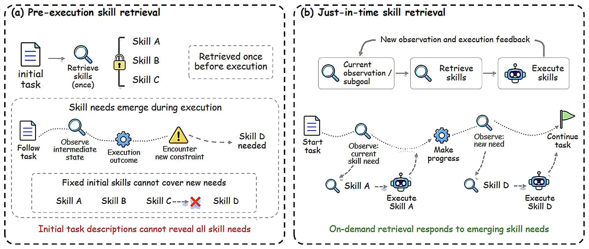
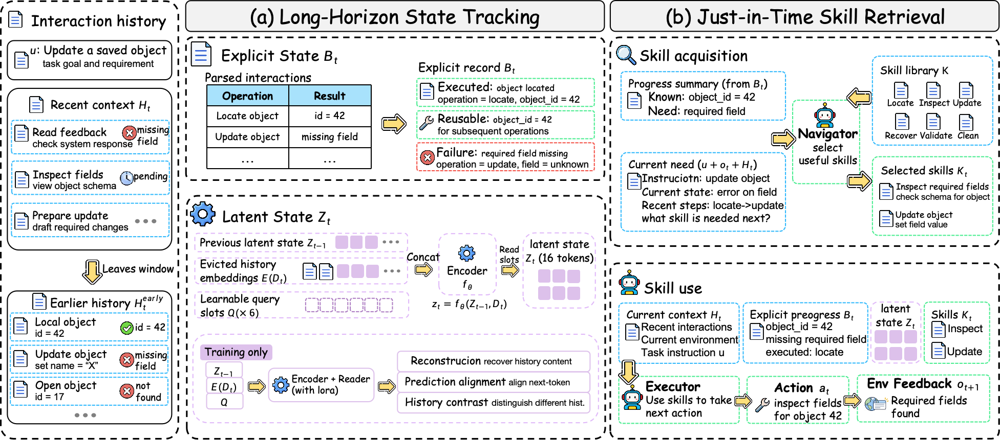

<div align="center">

# JitSkill
### Just-in-Time Skill Retrieval via Long-Horizon State Tracking

**[Paper](https://arxiv.org/abs/2611.01701)** · **[Method](#method)** · **[Installation](#installation)** · **[Training](#training)** · **[Serving](#serving)** · **[Paper-to-code mapping](docs/paper_alignment.md)**

</div>

Large Language Model (LLM)-based agents can reuse procedural knowledge through external skill libraries. Existing retrieval methods, however, typically choose a fixed skill set before execution. This is restrictive for long-horizon interaction, where intermediate observations, execution outcomes, and newly revealed constraints expose procedural needs that the initial instruction does not specify.

## Just-in-Time Skill Retrieval

<p align="center"></p>

*Introduction illustration exported from page 1 of `resources/intro.pdf` in the paper's Overleaf project. Pre-execution retrieval can miss needs revealed during execution, whereas just-in-time retrieval acquires skills on demand as needs become observable.*

JitSkill couples this execution-time retrieval paradigm with task-state tracking. A candidate skill should be judged not only by the current observation, but also by prior execution: what has been completed, which results can be reused, which attempts have failed, and which requirements remain unresolved. This avoids **execution drift**, in which locally plausible skill decisions repeat completed work or conflict with accumulated task progress.

## Method

<p align="center"></p>

*Method overview from the paper. Explicit records and latent representations jointly track task progress, guiding both skill retrieval and action generation.*

JitSkill maintains an evolving task-progress state **S_t = (B_t, Z_t)**. The explicit record **B_t** organizes inspectable execution evidence, including operations, outcomes, and failure feedback. The fixed-size latent state **Z_t** recurrently carries forward historical context that is difficult to enumerate as a small set of textual fields. The same state grounds both skill retrieval and subsequent execution.

1. **Track progress.** A recurrent encoder updates latent slots from new action--feedback evidence, while the explicit record retains directly inspectable task facts.
2. **Acquire skills.** At each decision point, a navigator combines the tracked state with current execution context to select the skill subset needed next from the library.
3. **Use skills.** A frozen executor receives the current context, selected skills, explicit record, and projected latent state tokens to generate the next action.
4. **Update.** The action and environment feedback update task progress, making their consequences available to later skill decisions.

Training proceeds in three stages. The encoder is first pretrained with a history-compression objective, then jointly fine-tuned with the navigator using next-step skill supervision, and finally used to train the executor-side projection. A description-conditioned scoring head supports changes to the skill library without retraining.

## Results

Across SkillsBench, ALFWorld, and $\tau^2$-Bench, JitSkill achieves the highest overall task-success rates reported in the paper. On SkillsBench, it improves over the strongest execution-time retrieval baseline by **20.6%** relatively. See the [paper](https://arxiv.org/abs/2611.01701) for experimental protocols, baselines, and analyses.

## Installation

```bash
python -m pip install -e .
python -m unittest discover -s tests -v
```

Model training requires model weights and suitable GPU memory. Serving additionally requires a vLLM build supporting chat `prompt_embeds`; validate its tokenizer and embedding behavior before evaluation.

## Training

Supply the official-training trajectories and skill library in the [documented formats](docs/data_formats.md). No benchmark data, model weights, private trajectories, or pretrained JitSkill checkpoints are included.

```bash
export ENCODER_BASE=/path/to/encoder
export EMBEDDER=/path/to/all-MiniLM-L6-v2
export TRAIN_TRAJECTORIES=/path/to/train.jsonl
export SKILLS=/path/to/skills.jsonl
export WORK_DIR=work
export ALPHA="${ALPHA:?set the fusion weight selected for the teacher benchmark}"
bash scripts/train_compression.sh
export COMPRESSOR_CKPT=work/compression.pt
bash scripts/train_navigator.sh
```

**External prerequisite for projection training:** run the executor on the official training split with a benchmark harness that records raw, pre-injection calls. The harness and its logging adapter are not included in this repository. Supply `work/teacher/tasks/<task_id>/logs/lm_calls.jsonl` with `input.messages` and `output.choices[0].message.content`, and `work/teacher/successes.json` listing successful task IDs. `work/teacher` is an external input directory, not an output of the training scripts. The supplied corpus builder reads AppWorld-shaped user-turn logs; other benchmarks require an external adapter matching the [data contracts](docs/data_formats.md).

Build row-aligned explicit/skill prompts and latent states using the same fusion weight as serving:

```bash
python -m jitskill.executor.build_sft_corpus \
  --exp work/teacher --successes work/teacher/successes.json \
  --out work/actions.jsonl --latent_out work/states.npy \
  --tokenizer /path/to/frozen-executor --skills /path/to/skills.jsonl \
  --emb_model /path/to/all-MiniLM-L6-v2 --nav_base /path/to/encoder \
  --nav_ckpt work/nav_nav.pt --enc_dir work/nav_enc --nav_device cuda:0 \
  --alpha "$ALPHA"

export EXECUTOR_DIR=/path/to/frozen-executor
export SFT_ROWS=work/actions.jsonl
export LATENT_ROWS=work/states.npy
bash scripts/train_projection.sh
```

Compression training saves the final encoder checkpoint without validation-based selection. Both the shell script and the Python navigator CLI require this checkpoint (`COMPRESSOR_CKPT` / `--init_encoder`). Navigator and projector training use scenario-disjoint validation for checkpoint selection: navigator recall@1 and projector next-action loss, respectively. Projector optimizer defaults are listed in [alignment details](docs/paper_alignment.md).

## Serving

```bash
export EXECUTOR_DIR=/path/to/frozen-executor
export NAV_BASE=/path/to/encoder
export NAV_CKPT=work/nav_nav.pt
export ENC_DIR=work/nav_enc
export PROJECTOR=work/projector.pt
export SKILLS=/path/to/skills.jsonl
export JITSKILL_EMB_MODEL=/path/to/all-MiniLM-L6-v2
# ALFWorld example; replace with the training-selected weight for your benchmark.
export ALPHA=0.75
export INJECTION_ROLE=user
bash serving/serve_executor.sh
```

Point the benchmark harness to `http://127.0.0.1:8100/v1`, with model `lk=<unique-episode-id>::k=3`. This string contains proxy session controls: `lk` identifies the episode, `k` sets the skill count, and optional `bud` sets the token budget (default 1,200). It is not the executor's model ID. The proxy forwards requests with `MODEL_NAME` (default `executor`), the model name served by vLLM.

Use a new `lk` for every episode, including reruns of the same task. The proxy rejects missing or blank keys with HTTP 400. Repeated requests with the same history do not advance latent state again. Requests must include raw history before JitSkill injection. Streaming requests are not supported.

Use `INJECTION_ROLE=user` for ALFWorld/AppWorld, `tool` for SkillsBench, and `system` for tau2-Bench. With `tool`, the SkillsBench adapter must provide an existing, injectable `tool` result in every request, including the initial decision; setting the environment variable alone does not supply this message. Requests without a tool result receive HTTP 400. SkillsBench libraries can provide a compact `inject` pointer containing the skill name, purpose, and mounted `SKILL.md` path.

`ALPHA` is required by the launch script and `--alpha` by the proxy CLI. There is no default fusion weight. ALFWorld uses 0.75; for SkillsBench or tau2-Bench, explicitly supply the weight selected on the designated training data, not on evaluation tasks.

For the automatic proxy, use [`prompts/alfworld_jitskill_executor.txt`](prompts/alfworld_jitskill_executor.txt) rather than the archived shared ALFWorld template: retrieval occurs before every action decision, so the executor should emit an environment action instead of a `SkillRequest`.

## Release scope

Included: progress tracking, compression and navigation training, projector training, executor proxy, prompt templates, and component tests. Not included: benchmark harnesses or their adapters, pretrained checkpoints, raw trajectories, or result logs.

The Introduction illustration is a page-1 export of the Overleaf project's `resources/intro.pdf`; the current LaTeX Introduction instead references `resources/skilljit_intro1.png`. The README export and the LaTeX image are distinct assets. The README also displays the pipeline illustration. Figure sources and implementation settings are tracked in [docs/paper_alignment.md](docs/paper_alignment.md). The archived appendix prompt and the proxy-compatible runtime prompt are in `prompts/`.
