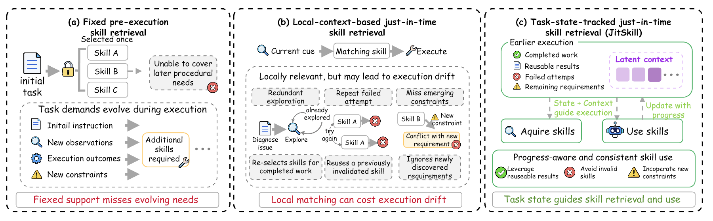

<div align="center">

# JitSkill
### Just-in-Time Skill Retrieval via Long-Horizon State Tracking

Explicit and latent task progress jointly guide skill acquisition and use.

</div>

<p align="center"></p>

*Figure 1 from the paper.* Fixed initial retrieval can miss emerging needs and retain skills that are no longer needed. Skill decisions based on local execution context can overlook prior progress, leading to redundant exploration and execution-consistency deviation. An evolving task-progress state jointly guides skill acquisition and execution.

[Method](#method) · [Installation](#installation) · [Training](#training) · [Serving](#serving) · [Prompts](prompts/README.md) · [Paper-to-code mapping](docs/paper_alignment.md)

## Method

JitSkill maintains an evolving task-progress state **S_t = (B_t, Z_t)**. The explicit record **B_t** stores inspectable execution evidence. The fixed-size latent state **Z_t** recurrently integrates preceding action–feedback blocks. Both representations condition skill navigation, and the executor receives the selected skills together with the same explicit record and projected latent state tokens.

1. **Track progress.** Extract bounded explicit records from observed execution and update 16 latent slots with a frozen Qwen3-8B backbone adapted through encoder LoRA.
2. **Acquire skills.** Map the slot-averaged latent state and the all-MiniLM-L6-v2 embedding of the explicit record to a query. Combine learned skill scores with current-step lexical relevance and select up to three skills within a 1,200-token skill budget.
3. **Use skills.** A learned projection maps the latent slots to the frozen 27B executor's input embedding space. Train only this projection with recorded next-action likelihood; the executor remains fixed.
4. **Update.** The resulting action and environment feedback become evidence for the next decision.

Training proceeds in three stages. The encoder is first pretrained with the history-compression objective, then jointly fine-tuned with the navigator using next-step skill supervision, and finally used to train the executor-side projection. A description-conditioned scoring head supports changing the skill library without retraining.

## Installation

```bash
python -m pip install -e .
python -m unittest discover -s tests -v
```

Model training requires model weights and suitable GPU memory. Serving additionally requires a vLLM build supporting chat `prompt_embeds`; validate its tokenizer and embedding behavior before evaluation.

## Training

Supply the official-training trajectories and skill library in the [documented formats](docs/data_formats.md). No benchmark data, model weights, private trajectories, or pretrained JitSkill checkpoints are included.

```bash
export ENCODER_BASE=/path/to/encoder
export EMBEDDER=/path/to/all-MiniLM-L6-v2
export TRAIN_TRAJECTORIES=/path/to/train.jsonl
export SKILLS=/path/to/skills.jsonl
export WORK_DIR=work
bash scripts/train_compression.sh
export COMPRESSOR_CKPT=work/compression.pt
bash scripts/train_navigator.sh
```

Next, collect raw, pre-injection executor requests on the official training split using the benchmark harness. Build row-aligned explicit/skill prompts and latent states:

```bash
python -m jitskill.executor.build_sft_corpus \
  --exp work/teacher --successes work/teacher/successes.json \
  --out work/actions.jsonl --latent_out work/states.npy \
  --tokenizer /path/to/frozen-executor --skills /path/to/skills.jsonl \
  --emb_model /path/to/all-MiniLM-L6-v2 --nav_base /path/to/encoder \
  --nav_ckpt work/nav_nav.pt --enc_dir work/nav_enc --nav_device cuda:0

export EXECUTOR_DIR=/path/to/frozen-executor
export SFT_ROWS=work/actions.jsonl
export LATENT_ROWS=work/states.npy
bash scripts/train_projection.sh
```

Scenario-disjoint validation is used for checkpoint selection. Projector optimizer defaults are implementation choices because the paper does not specify its learning rate or gradient accumulation; see [alignment details](docs/paper_alignment.md).

## Serving

```bash
export EXECUTOR_DIR=/path/to/frozen-executor
export NAV_BASE=/path/to/encoder
export NAV_CKPT=work/nav_nav.pt
export ENC_DIR=work/nav_enc
export PROJECTOR=work/projector.pt
export SKILLS=/path/to/skills.jsonl
export JITSKILL_EMB_MODEL=/path/to/all-MiniLM-L6-v2
bash serving/serve_executor.sh
```

Point the benchmark harness to `http://127.0.0.1:8100/v1`, with model `lk=<unique-episode-id>::k=3::bud=1200`. Each episode must have a unique key; repeated requests with the same history do not advance its latent state again. Requests must include raw history before JitSkill injection. Streaming requests are not supported.

Use `INJECTION_ROLE=user` for ALFWorld/AppWorld, `tool` for SkillsBench, and `system` for tau2-Bench. The ALFWorld fusion weight is 0.75; other benchmark weights must be selected only on their training split. SkillsBench libraries can provide a compact `inject` pointer containing the skill name, purpose, and mounted `SKILL.md` path.

For the automatic proxy, use [`prompts/alfworld_jitskill_executor.txt`](prompts/alfworld_jitskill_executor.txt) rather than the archived shared ALFWorld template: retrieval occurs before every action decision, so the executor should emit an environment action instead of a `SkillRequest`.

## Release scope

This release implements the paper's core progress tracking, navigation, projector training, and executor interface. Benchmark-specific harness adapters and full end-to-end benchmark reproduction remain to be validated. Unit tests use synthetic evidence and a small frozen decoder; their success does not establish the paper's benchmark scores.

The illustration and research description above come from the paper's Introduction, Method, and Method Details. The archived appendix prompt and the proxy-compatible runtime prompt are in `prompts/`. The source-to-equation mapping and known paper ambiguities are recorded in `docs/paper_alignment.md`.
